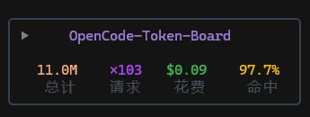
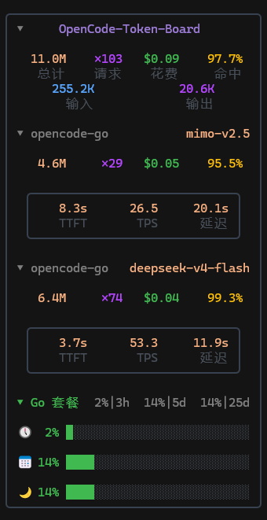

# opencode-token-board

> **OpenCode V2 实时 Token 统计面板**
> Real-time token usage & performance dashboard plugin for OpenCode V2.

一个运行在 OpenCode V2 TUI 侧边栏的实时面板，让你**亲眼看见**每次对话的 Token 消耗、缓存命中率与响应性能：
A live sidebar dashboard for the OpenCode V2 TUI that lets you **see** your token consumption, cache hit rate and response performance in real time:

- 📊 **实时 Token 统计** — 输入/输出/推理 Token、成本，随对话滚动更新 / Real-time input/output/reasoning tokens & cost
- ⚡ **缓存命中率** — 上下文缓存命中可视化，帮你判断 prompt 复用效果 / Visual cache-hit rate to gauge prompt reuse
- 🚀 **性能指标** — TTFT / TPS / 延迟 + P50/P95/P99 分位数，追踪模型响应速度 / TTFT, TPS, latency with percentiles
- 📈 **报告导出** — HTML / JSON / Markdown / CSV 一键生成，数据落盘 `~/.opencode/reports/` / One-click HTML/JSON/Markdown/CSV reports
- 💰 **Go 余额查询** — 查询 OpenCode Go 套餐余量 / Check your OpenCode Go plan balance
- 🔔 **原生完成通知** — 会话结束用 OpenCode V2 内置 attention 发系统通知 + 音效 / Native completion notification via OpenCode V2 attention

本项目基于 [opencode-token-watch](https://github.com/Howardzhangdqs/opencode-token-watch) 修改而来，特此鸣谢原项目作者。

**面板预览**




> ⚠️ **V2 专属**：本插件 1.0.0+ 使用 OpenCode V2 插件 API（`@opencode/plugin`），**不兼容** OpenCode V1 与 MiMoCode。V1 用户请停留在 0.2.x。

## 系统要求

- **OpenCode V2**（2.x，实测 2.0.29）
- Node.js 18+（报告功能在插件运行时用 `bun:sqlite`，本地测试用 `node:sqlite`）

## 安装

```sh
npm install -g opencode-token-board
```

在 `opencode.json` 或 `opencode.jsonc`（服务端）与 `cli.json`（TUI）中添加：

```jsonc
// opencode.json(c)
{
  "$schema": "https://opencode.ai/config.json",
  "plugins": ["opencode-token-board"]
}
```

```json
// ~/.config/opencode/cli.json（TUI 插件）
{
  "plugins": [{ "package": "opencode-token-board", "options": { "enabled": true } }]
}
```

> V2 把 v1 的 `plugin` 数组改为 `plugins`，元组 `[pkg, options]` 改为对象 `{ package, options }`。

## 用法

在 OpenCode TUI 中输入 `/usage`，选择：

- **HTML 报告** — 选择日期范围，生成仪表盘并在浏览器打开
- **JSON 导出** — 导出完整用量数据至 `~/.opencode/reports/`
- **文本报告** — 导出 Markdown 格式至 `~/.opencode/reports/`
- **设置** — 开关侧边栏显示项、切换语言、配置 Go

配置自动持久化到插件存储（跨 TUI 实例同步），无需手动编辑配置文件。

## 配置 OpenCode Go 套餐余量查询

1. 输入 `/usage` → **设置** → **Go 配置**
2. 打开用量查询页面 <https://opencode.ai/workspace/wrk_xxx/go>，将 `wrk_xxx` 填入 **Workspace**
3. 按 `F12` 打开开发者工具 → **应用程序** → **Cookie**，找到 `auth`，复制整段文本填入 **Cookie**
4. 点击完成后重启 TUI

也可复用 [opencode-go-usage](https://github.com/) 插件的配置文件 `~/.config/opencode/opencode-go-usage.json`，避免重复填 Cookie。

## 数据文件

| 文件 | 路径 | 说明 |
|------|------|------|
| JSONL 日志 | `~/.opencode/tokenwatch.jsonl` | 性能样本（TTFT/TPS/延迟），5MB 自动轮转 |
| 聚合统计 | `~/.opencode/tokenwatch-stats.json` | 持久化全量性能统计（报告用） |
| 报告输出 | `~/.opencode/reports/` | HTML / JSON / Markdown 报告 |
| 插件配置 | OpenCode 插件存储（`ctx.storage`） | 显示开关 / 语言 / Go 配置 / 折叠态 |

> 报告的用量数据**直接读取 OpenCode 的 SQLite 数据库**（`~/.local/share/opencode/opencode.db`），
> 无需 `opencode db` 命令（该命令已在 V2 删除）。实测 V2 的 `session_message` 表已包含全部历史数据。

## 构建

```sh
npm install
npm run build      # tsc + esbuild → dist/server.js + dist/tui.js
npm run typecheck  # 仅类型检查
```

## V1 → V2 迁移要点

本插件 1.0.0 完成 V1 → V2 插件 API 迁移，关键变化：

| 维度 | V1 | V2 |
|------|----|----|
| SDK | `@opencode-ai/plugin` | `@opencode/plugin`（服务端）/ `@opencode/plugin/tui`（CLI） |
| 入口 | `{ id, server }` / `{ id, tui }` | `Plugin.define({ id, setup(ctx) })` |
| 事件 | `api.event.on` + `event.properties` | `ctx.data.on` + `event.data` |
| 数据源 | 逐 `message.updated` 抠 token | `ctx.data.session.message.list()` 为唯一事实源 |
| 持久化 | `api.kv`（轮询版本号） | `ctx.storage.store`（响应式 Store） |
| 槽位 | `api.slots.register(sidebar_content)` | `ctx.ui.slot({ append: "sidebar.content" })` |
| 菜单 | `DialogSelect` 组件栈 | `ctx.keymap.layer` + `ctx.ui.dialog.select`（Promise） |
| 通知 | 自建 Windows 弹窗 | `ctx.attention.notify`（原生系统通知+音效） |
| 报告数据源 | `opencode db` CLI | SQLite 直连（`bun:sqlite` / `node:sqlite`） |

**Windows 权限弹窗功能已移除**（退回 V2 原生权限提示 + attention 通知）。

## 本地开发 / 测试

V2 对本地路径插件的加载：

- **项目 `.opencode/plugins/`** — 自动发现，最可靠。把构建产物或软链放这里即可本地测试：
  ```sh
  # 在任意测试项目里
  mkdir -p .opencode/plugins
  # 写一个 re-export 或直接指向本地 dist
  ```
- **全局配置本地路径**（`plugins: ["file:///D:/path"]`）— 实测**启动时不加载**；npm 包名才从缓存加载。开发期建议用项目 `.opencode/plugins/`，发布后用 npm 包名。
- 加载 npm 包插件前确认缓存已更新：`~/.cache/opencode/packages/opencode-token-board@latest/`。

## 相关项目

- [opencode-throughput](https://github.com/Howardzhangdqs/opencode-throughput) — 实时 LLM 性能监控，采集 TTFT/TPS/延迟和成本
- [opencode-visual-cache](https://github.com/Hotakus/opencode-visual-cache) — TUI 侧边栏缓存命中率可视化，Token 分布分析
- [magic-context](https://github.com/cortexkit/magic-context/) — 缓存感知的无限上下文 + 跨会话记忆系统
- [opencode-token-watch](https://github.com/Howardzhangdqs/opencode-token-watch) — OpenCode 侧边栏显示 Token 用量

## 许可

MIT
